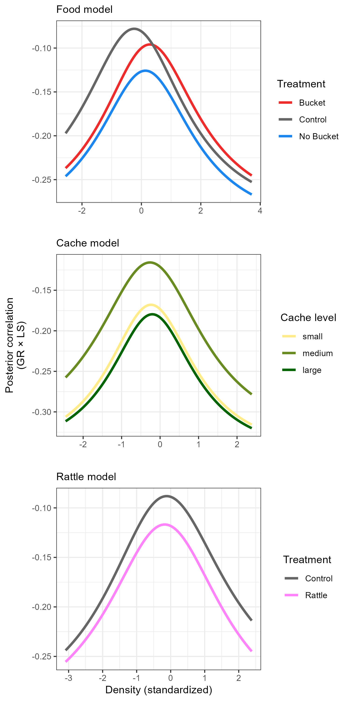

```{r setup, include=FALSE}
knitr::opts_chunk$set(echo = TRUE)
```

```{r sourcing, include=FALSE}
#source the R folder to load any packages and functions
lapply(dir('R', '*.R', full.names = TRUE), source)

#read in finalized data
dat <- readRDS("Output/Data/full_cleaned_litters.rds")
controls <- readRDS("Output/Data/control_cleaned_litters.rds")
food <- readRDS("Output/Data/food_cleaned_litters.rds")
cache <- readRDS("Output/Data/cache_cleaned_litters.rds")
rattle <- readRDS("Output/Data/rattle_cleaned_litters.rds")

```

## Figures:


![The relationship between litter growth rate (g/day) and litter size, using control grid data only (n = `r controls[, .N]`).](Output/Figures/GR_littersize.jpeg)

![The relationship between litter growth rate (g/day) and litter size, categorized into three difference categories of local density (low = red, medium = green, and high = blue), described using linear models that interacted litter size with density and treatment or food levels. Left: model used control and food add grids (n = `r food[, .N]`) and interacted litter size with density and individual food treatment (control, bucket, or no bucket). Middle: model used all litters with cache size data (n = `r cache[, .N]`) and interacted litter size with density and the mother's cache size in the previous year (categorical, either small, medium, or large). Right: Model used litters from control and rattle treatment grids during years of rattle experiments (n = `r rattle[, .N]`) and interacted litter size with density and treatment (control vs. rattle).](Output/Figures/lm_full.jpeg)



