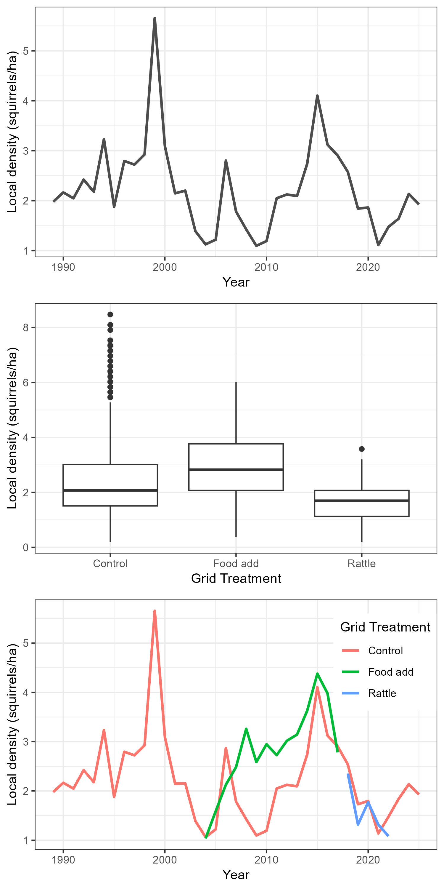
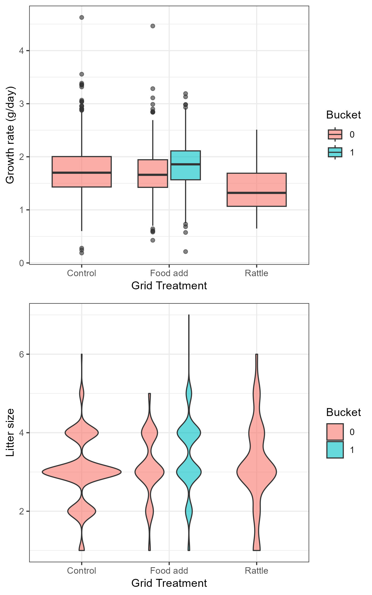

```{r setup, include=FALSE}
knitr::opts_chunk$set(echo = TRUE)
```

```{r sourcing, include=FALSE}
source("Scripts/09-summary_figures.R")
```

## Figures:






![The relationship between litter growth rate (g/day) and litter size, using control grid data only (n = `r controls[, .N]`).](Output/Figures/GR_littersize.jpeg)

![The relationship between litter growth rate (g/day) and birth date (Julian day), using control grid data only (n = `r controls[, .N]`).](Output/Figures/GR_birthmonth.jpeg)

![Top: litter growth rate (g/day) in response to litter size for control grids only (n = `r controls[, .N]` , colored by local density level. Bottom: litter growth rate (g/day) in response to litter size on food add grids only (n = `r food[, .N]` ), parsed by food add treatment of the mother (with a bucket or without a bucket), and colored by local density level.](Output/Figures/lm_results.jpeg)
