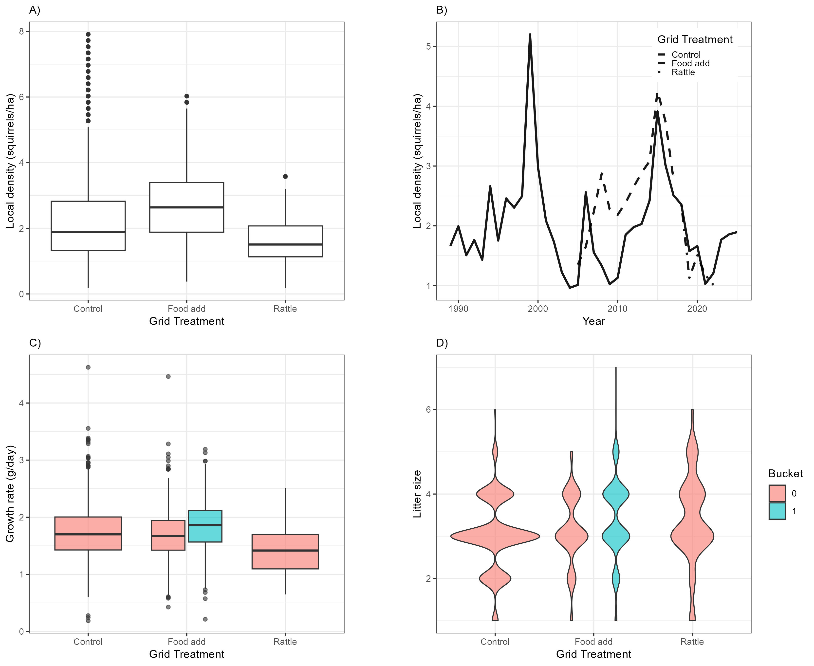
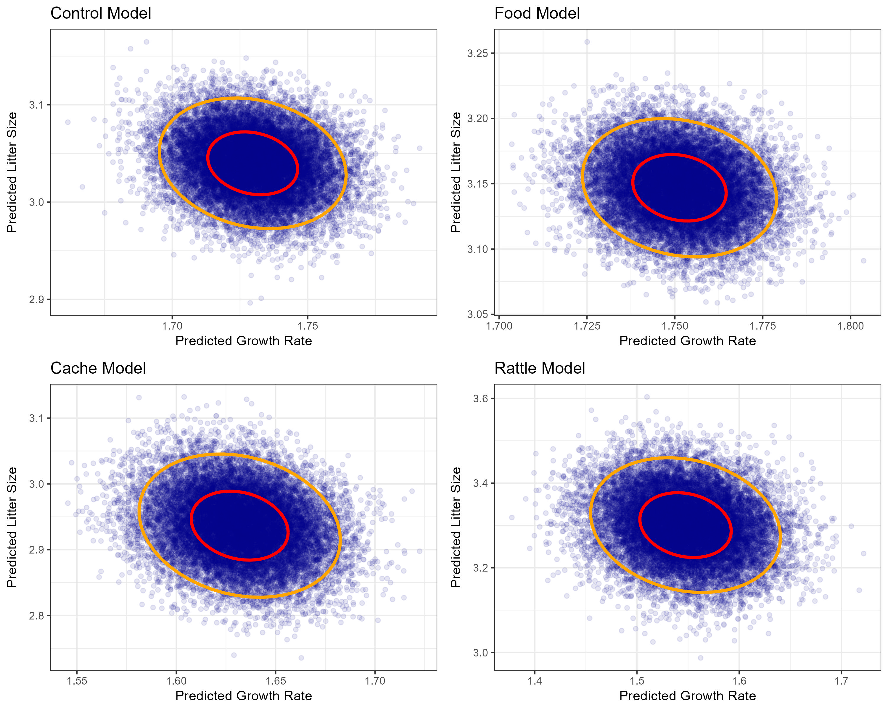
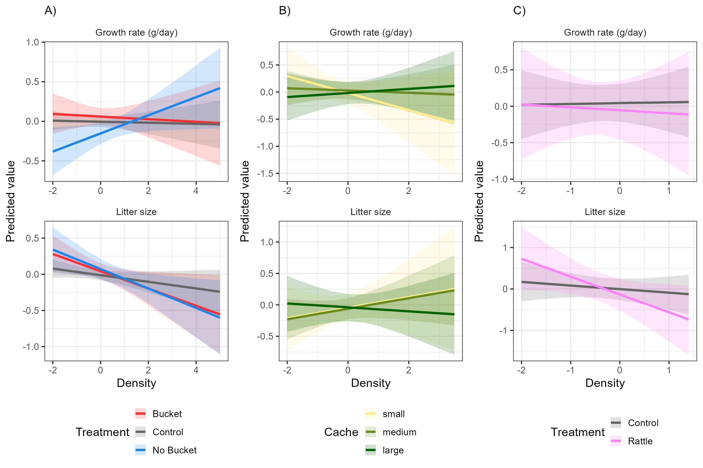

```{r setup, include=FALSE}
knitr::opts_chunk$set(echo = TRUE)
```

```{r sourcing, include=FALSE}
#source the R folder to load any packages and functions
lapply(dir('R', '*.R', full.names = TRUE), source)

#read in finalized data
dat <- readRDS("Output/Data/full_cleaned_litters.rds")
controls <- readRDS("Output/Data/control_cleaned_litters.rds")
food <- readRDS("Output/Data/food_cleaned_litters.rds")
cache <- readRDS("Output/Data/cache_cleaned_litters.rds")
rattle <- readRDS("Output/Data/rattle_cleaned_litters.rds")

```

Figure Captions

Figure 1. Summary of density and life history outcomes in response to treatments (n = `r dat[, .N]`). A) Local densities (ind/ha) of red squirrels in response to treatment at the grid level. B) Average local density (ind/ha) of squirrels over time and in response to grid-level treatment (line type). C) litter growth rate (g/day) in response to treatment. D) litter size in response to treatment. In C and D treatment is shown as a combination of grid-level and mother-level treatment; a mother was either on a control grid, was on a food grid and had a bucket (turquoise fill), was on a food grid but did not have a bucket, or was on a rattle playback grid.

Figure 2. Raw data from control grids (n = `r controls[, .N]`) showing the overall negative trade-off between litter size and litter growth rate (g/day). Linear relationship is shown.

Figure 3. Best linear unbiased predictors from all three Bayesian models, food, cache, and rattle, that test how growth rate and litter size respond to local density. After all fixed effects and random effects are accounted for, this is how litter size and growth rate relate to one another in each scenario. Data points represent litters, red ellipses represent the 50% confidence levels, and orange ellipses represent the 95% confidence levels.

Figure 4. Separate

Figures









Supplementary Figures

(these are just extra things I thought would be handy to keep for now)

S1. Visual example of how local density was estimated using squirrel census data. All grey points represent the locations (meters) of censused squirrels on one grid during one spring, with one squirrel randomly selected in red. Density was calculated for each squirrel each spring by tallying the number of censused squirrels whose locations fell within a r radius m radius (red circle) of that squirrel's location divided by the area (pi\*radius\^2)/10000 .

S2. The relationship between litter growth rate (g/day) and litter size, categorized into three difference categories of local density (low = red, medium = green, and high = blue), described using linear models that interacted litter size with density and treatment or food levels. Left: model used control and food add grids (n = r food[, .N]) and interacted litter size with density and individual food treatment (control, bucket, or no bucket). Middle: model used all litters with cache size data (n = r cache[, .N]) and interacted litter size with density and the mother's cache size in the previous year (categorical, either small, medium, or large). Right: Model used litters from control and rattle treatment grids during years of rattle experiments (n = r rattle[, .N]) and interacted litter size with density and treatment (control vs. rattle).

S3. Posterior distributions of the covariance response from the three models, food, cache, and rattle.


