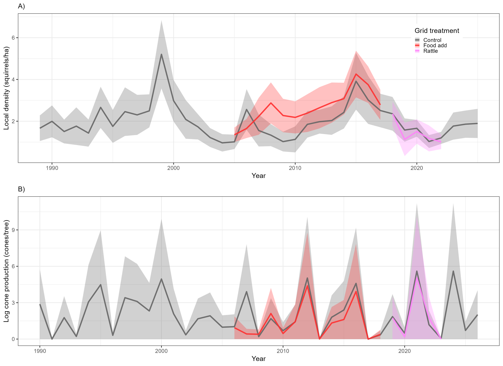
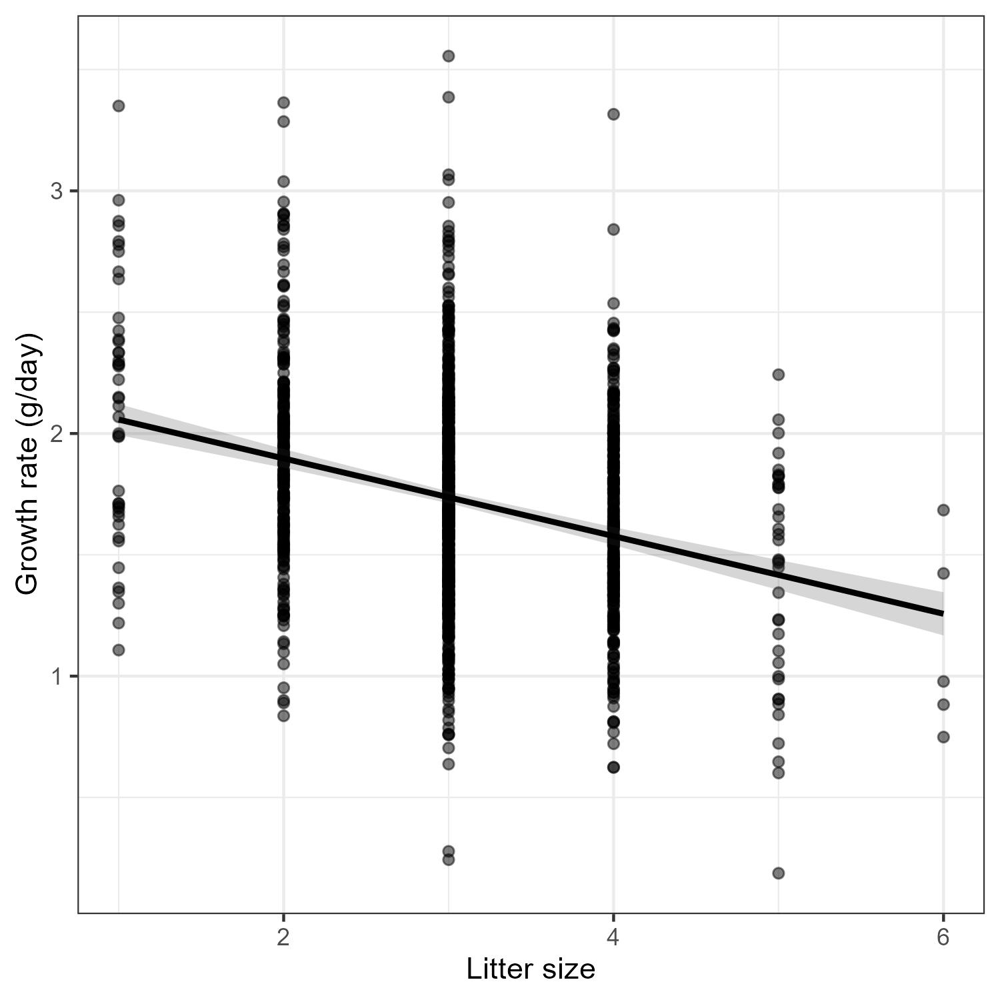
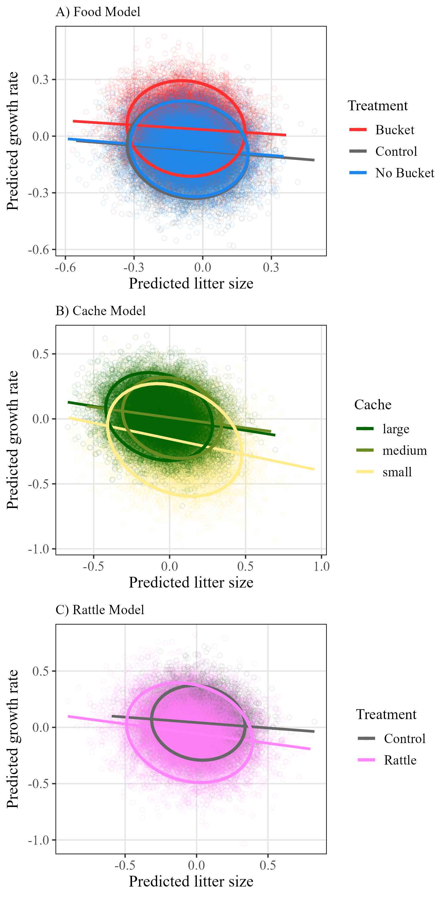
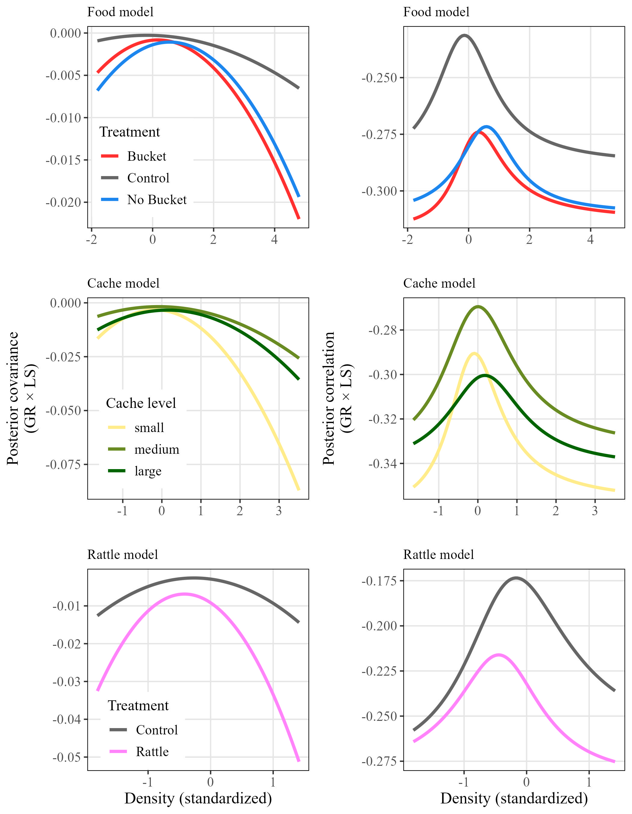
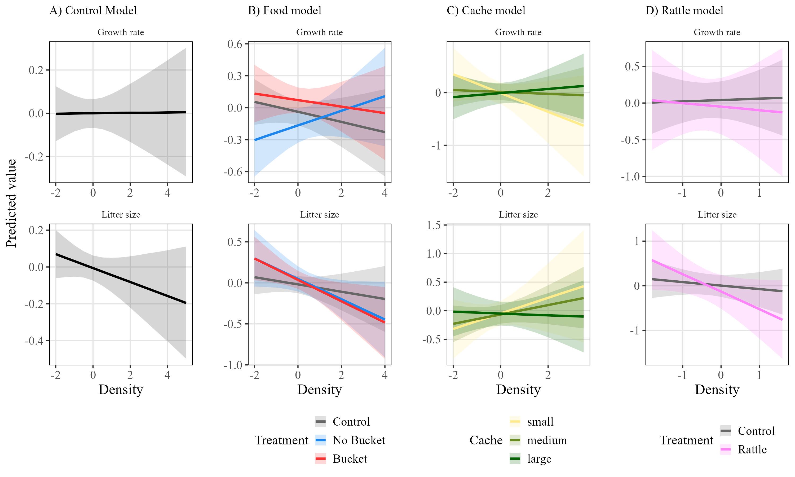

```{r setup, include=FALSE}
knitr::opts_chunk$set(echo = TRUE)
```

```{r sourcing, include=FALSE}
#source the R folder to load any packages and functions
lapply(dir('R', '*.R', full.names = TRUE), source)

#read in finalized data
dat <- readRDS("Output/Data/full_cleaned_litters.rds")
controls <- readRDS("Output/Data/control_cleaned_litters.rds")
food <- readRDS("Output/Data/food_cleaned_litters.rds")
cache <- readRDS("Output/Data/cache_cleaned_litters.rds")
rattle <- readRDS("Output/Data/rattle_cleaned_litters.rds")

#read in tables
tab1 <- fread("Output/Tables/Summary of grids and treatments.csv")
tab1[, V1 := NULL]

```

Tables

```{r, echo=FALSE, message=FALSE}
# Display as a styled table
knitr::kable(tab1, caption = "Table 1. Sample size of female red squirrels and litters and the years of those sample sizes, by grid, grid-treatment, and food treatment when applicable (on food-add grids).")
```

Figure Captions

Figure 1. Summary of the annual changes in A) squirrel densities (squirrels/ha) and B) spruce cone production (log cones/tree) over the `r dat[, length(unique(year))]`-long study in Kluane, Yukon. Lines representing squirrel densities (panel A) are colored by treatment of the study area (grey = food add, red = food add, fuchsia = rattle playbacks). Dashed vertical lines of the same colors delineate the time frames of each experiment, the food supplementation experiment (red) and the rattle playback experiment (fuchsia). Diamond points along the line representing cone production (panel B) indicates that the associated year was categorized as a mast year. Lines represent annual means and shaded areas represent the standard deviation.

Figure 2. Raw data from control grids (n = `r controls[, .N]`) showing the overall negative trade-off between litter size and litter growth rate (g/day). Linear relationship is shown.

Figure 3. Best linear unbiased predictors from all three Bayesian models, food (n = `r food[, .N]`), cache (n = `r cache[, .N]`), and rattle (n = `r rattle[, .N]`), that test how growth rate and litter size respond to local density. After all fixed effects and random effects are accounted for, this is how litter size and growth rate relate to one another in each scenario. Data points represent litters and are colored based on either A) food treatment, B) cache size, or C) rattle treatment. Linear relationships and 95% confidence levels are represented by lines and ellipses, respectively.

Figure 4. Predictions of the covariance (left column) and correlation (right column) between litter growth rate (GR) and litter size (LS) in response to local density based on three Bayesian models: Food model (top row), Cache model (middle row), and Rattle model (bottom row). Each model tested a different scenario or experiment. The Food model (n = `r food[, .N]`) tested how the interaction between a mother's local density and her food treatment (control = grey, food add grid with a bucket = red, food add grid with no bucket = blue) affects the relationship between litter growth rate and litter size. The Cache model (n = `r cache[, .N]`) tested how the interaction between a mother's local density and her cache size in the previous autumn (small = yellow, medium = light green, large = dark green) affects the relationship between litter growth rate and litter size. The Rattle model (n = `r rattle[, .N]`) tested how the interaction between a mother's local density and her perceived density treatment (control = grey, rattle playback = violet) affects the relationship between litter growth rate and litter size.

Figure 5. Linear predictions for litter growth rate (top row) and litter size (bottom row), separately, in response to local density based on four Bayesian models: A) Control model, B) Food model, C) Cache model, and D) Rattle model. Each model tested a different scenario or experiment, with the control model (A) being the base model. B) Predictions from the Food model (n = `r food[, .N]`) tested how the interaction between a mother's local density and her food treatment (control = grey, food add grid with a bucket = red, food add grid with no bucket = blue) affects the relationship between litter growth rate and litter size. C) Predictions from the Cache model (n = `r cache[, .N]`) that tested how the interaction between a mother's local density and her cache size in the previous autumn (small = yellow, medium = light green, large = dark green) affects the relationship between litter growth rate and litter size. D) Predictions from the Rattle model (n = `r rattle[, .N]`) that tested how the interaction between a mother's local density and her perceived density treatment (control = grey, rattle playback = violet) affects the relationship between litter growth rate and litter size.

Figures











Supplementary Figures

S1. Visual example of how local density was estimated using squirrel census data. All grey points represent the locations (meters) of censused squirrels on one grid during one spring, with one squirrel randomly selected in red. Density was calculated for each squirrel each spring by tallying the number of censused squirrels whose locations fell within a `r radius` m radius (red circle) of that squirrel's location divided by the area (pi\*radius\^2)/10000.

S2. Summary of density and life history outcomes in response to treatments (n = `r dat[, .N]`). A) Local densities (ind/ha) of red squirrels in response to treatment at the grid level, where grids housed either food-add experiments, rattle playback experiments, or were controls. B) Litter growth rate (g/day) and C) litter size in response to treatment of the mother. A mother was either on a control grid, was on a food grid and had a bucket, was on a food grid but did not have a bucket, or was on a rattle playback grid.

S3. Linear model predictions for the relationship between squirrel litter growth rate (g/day) and litter size as an interaction with three categories of squirrel density (low = red, medium = green, and high = blue). Left column: results from four different models, each using data subset to a different experimental treatment, controls (n = `r dat[treatment_ind == "Control", .N]`), buckets (n = `r dat[treatment_ind == "Bucket", .N]`), no buckets (n = `r dat[treatment_ind == "No Bucket", .N]`), and rattles (n = `r dat[treatment_ind == "Rattle", .N]`). Right column: results from one model that used all litters with cache size data (n = `r cache[, .N]`) and interacted litter size with density and the mother's cache size (categorical, either small, medium, or large).

S4. Predictions for all fixed effects from the control model which did not include any interacting term with density. Litters used in this model were from control grids across all years, and the model did not test for any effect of cache size.

S5. Posterior distributions of the covariance response from the three models, food, cache, and rattle.


