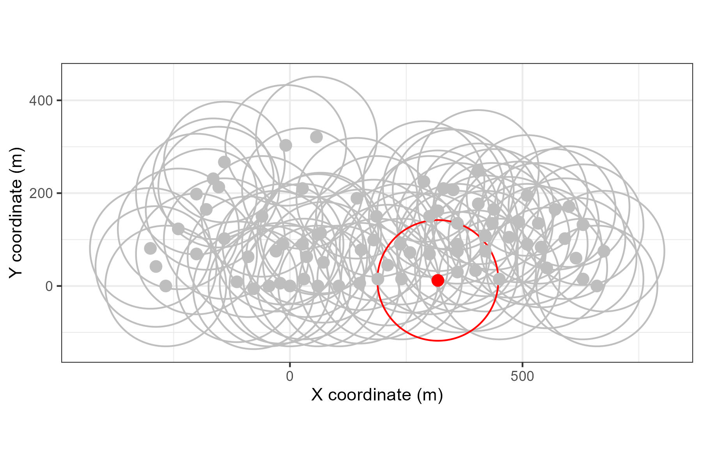
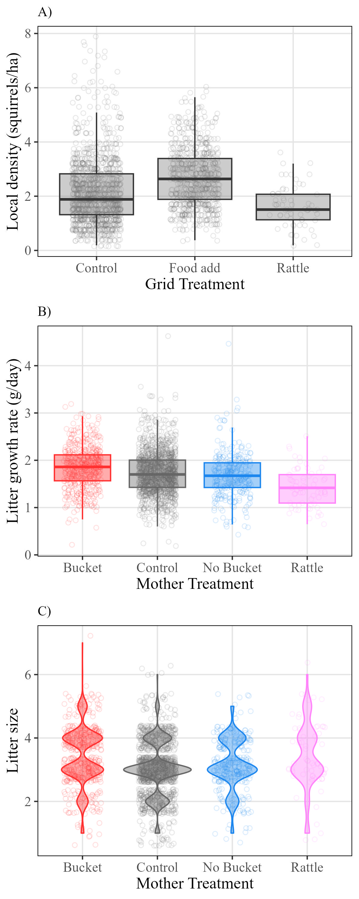
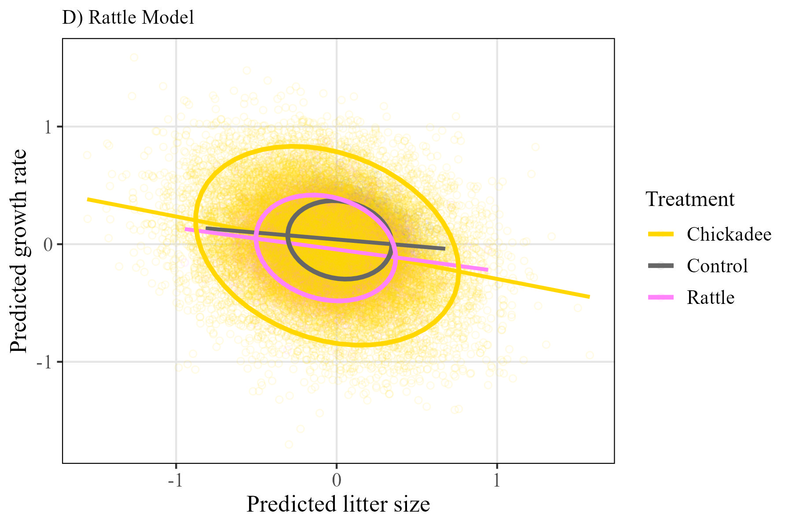
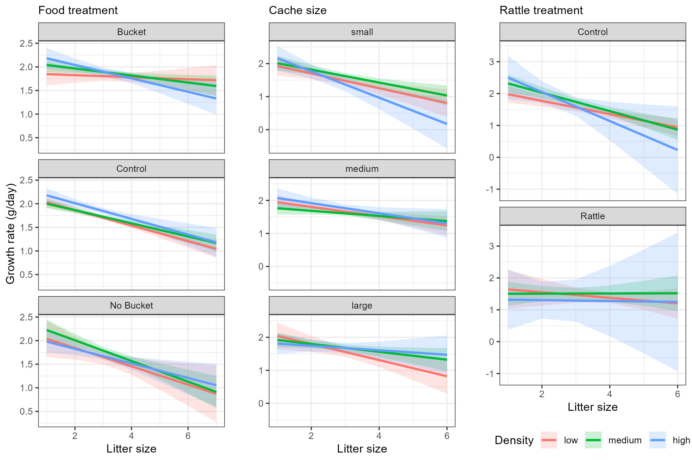
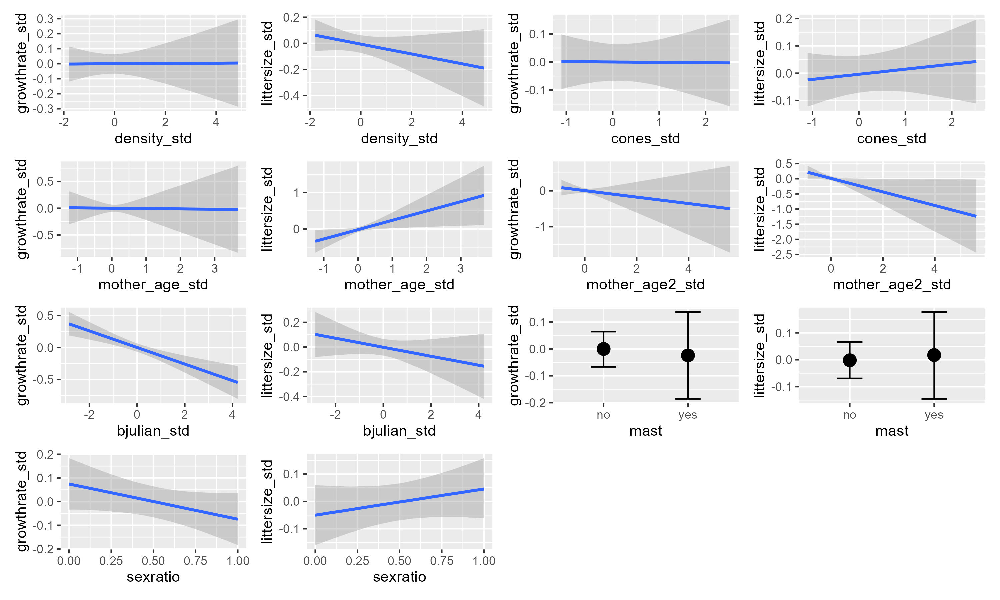
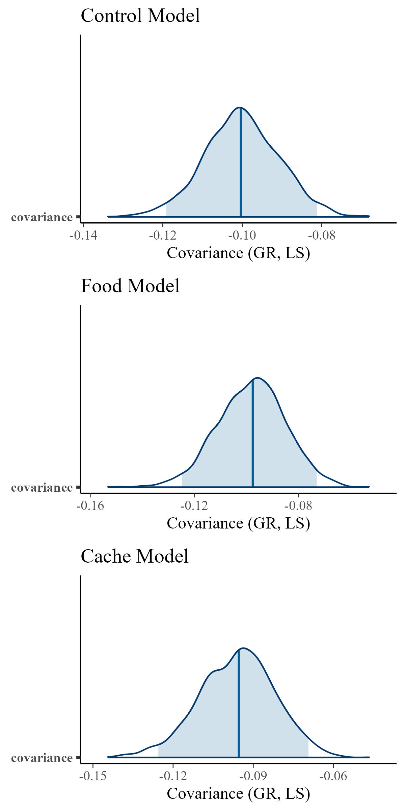

```{r setup, include=FALSE}
knitr::opts_chunk$set(echo = TRUE, warning = FALSE)
```

```{r sourcing, include=FALSE}
#source the R folder to load any packages and functions
lapply(dir('R', '*.R', full.names = TRUE), source)
library(sjPlot)

source("Scripts/09-summary_figures.R")

#read in finalized data
dat <- readRDS("Output/Data/full_cleaned_litters.rds")
controls <- readRDS("Output/Data/control_cleaned_litters.rds")
food <- readRDS("Output/Data/food_cleaned_litters.rds")
cache <- readRDS("Output/Data/cache_cleaned_litters.rds")
rattle <- readRDS("Output/Data/rattle_cleaned_litters.rds")

#read in tables
tab1 <- fread("Output/Tables/Summary of grid-treatments.csv")
tab1[, V1 := NULL]

tab2 <- fread("Output/Tables/Summary of experimental years.csv")
tab2[, V1 := NULL]


```


Supplementary Information

```{r tabS2, echo=FALSE, message=FALSE}
# Display as a styled table
knitr::kable(tab2, caption = "Supplementary Table 1. Sample size of juveniles, litters, and female red squirrels, by year, grid, and grid-treatment from 2010 - 2022.")
```


S1. Visual example of how local density was estimated using squirrel census data. All grey points represent the locations (meters) of censused squirrels on one grid during one spring, with one squirrel randomly selected in red. Density was calculated for each squirrel each spring by tallying the number of censused squirrels whose locations fell within a `r radius` m radius (red circle) of that squirrel's location divided by the area (pi\*radius\^2)/10000.

S2. Summary of density and life history outcomes in response to treatments (n = `r dat[, .N]`). A) Local densities (ind/ha) of red squirrels in response to treatment at the grid level, where grids housed either food-add experiments, rattle playback experiments, or were controls. B) Litter growth rate (g/day) and C) litter size in response to treatment of the mother. Females were subject to one of five treatment types: natural conditions (Control), controls for playback experiment (Chickadee playbacks), treatments for playback experiment (Rattle playbacks), controls on food add grids (No Bucket), or treatments on food add grids (Bucket).

S3. Best linear unbiased predictors from the rattle model with chickadee playback mothers tested as a separate treatment group.

S4. Linear model predictions for the relationship between squirrel litter growth rate (g/day) and litter size as an interaction with three categories of squirrel density (low = red, medium = green, and high = blue). Left column: results from four different models, each using data subset to a different experimental treatment, controls (n = `r dat[treatment_ind == "Control", .N]`), buckets (n = `r dat[treatment_ind == "Bucket", .N]`), no buckets (n = `r dat[treatment_ind == "No Bucket", .N]`), and rattles (n = `r dat[treatment_ind == "Rattle", .N]`). Right column: results from one model that used all litters with cache size data (n = `r cache[, .N]`) and interacted litter size with density and the mother's cache size (categorical, either small, medium, or large).

S5. Predictions for all fixed effects from the control model which did not include any interacting term with density. Litters used in this model were from control grids across all years, and the model did not test for any effect of cache size.

S6. Posterior distributions of the covariance response from the three models, food, cache, and rattle.












